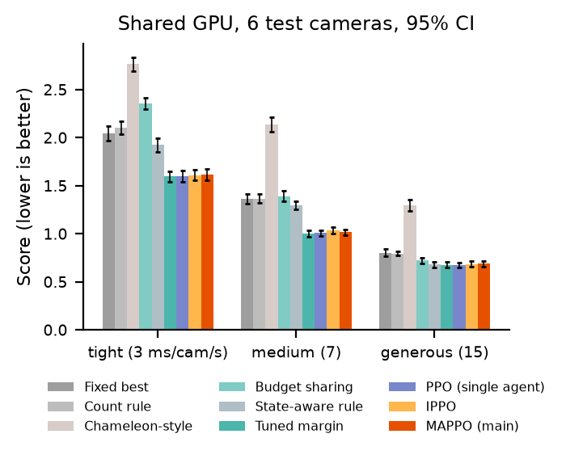
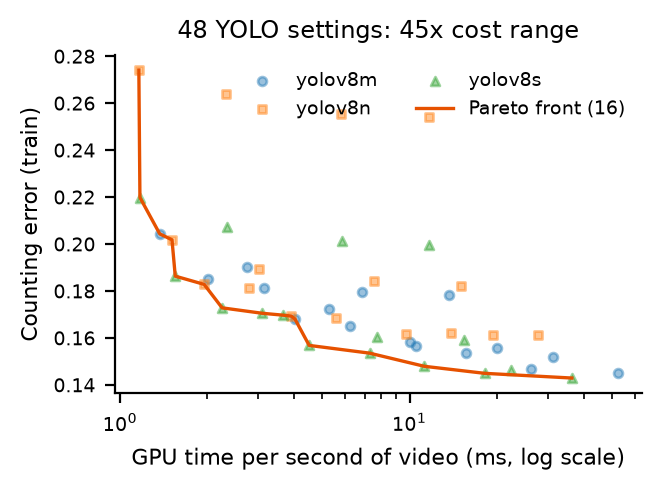
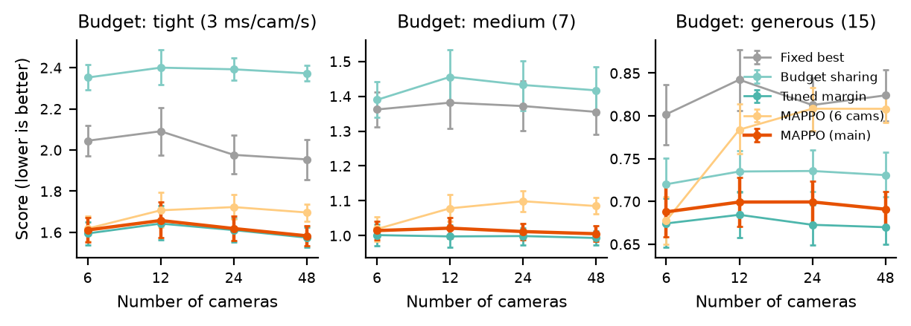
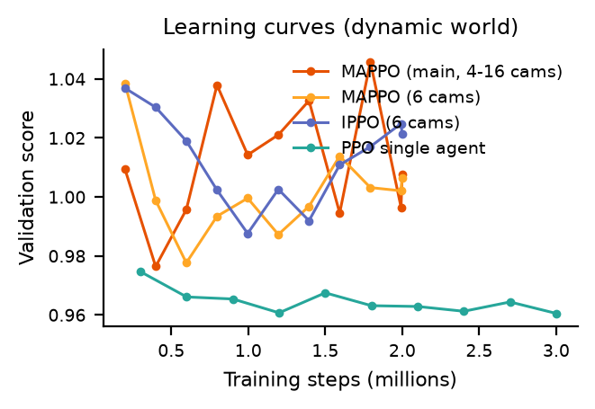
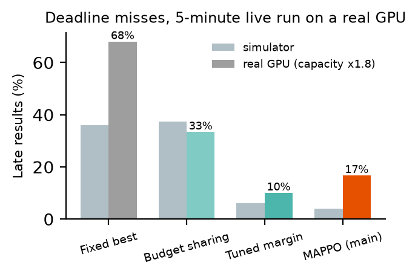

# OptiVision: Budget-Aware Multi-Agent Reinforcement Learning for Adaptive Video Intelligence

**OptiVision** is a MAPPO-based framework that allocates a shared GPU budget across many video streams by adapting
each stream's detection model, resolution and frame rate, maximising analytical accuracy while keeping computation
and latency within budget. It targets video surveillance, industrial inspection, traffic monitoring and public
safety; this repository evaluates it on **city traffic monitoring** (vehicle counting with YOLO on UA-DETRAC).
A **MAPPO** policy trained on 4–16 cameras runs systems of up to **48 cameras without retraining**, and on unseen
test cameras beats the fixed configurations used in practice by **14–26%**.

**Team members:** Krish Teckchandani (B23CS1092), Utkarsha (B24CM1062)  
**Repository:** https://github.com/UTKARSHA1267/Opti_Vision

---

## Installation

Requires Python 3.11 and, for training or the real-GPU check, an NVIDIA GPU with CUDA 12.4. Evaluating the
trained agents runs on CPU.

```bash
git clone https://github.com/UTKARSHA1267/Opti_Vision.git
cd Opti_Vision
conda create -n optivision python=3.11 -y
conda activate optivision
pip install torch==2.6.0 torchvision==0.21.0 --index-url https://download.pytorch.org/whl/cu124
pip install -r requirements.txt
```

## Dependencies

All pinned in `requirements.txt`: PyTorch 2.6.0 (CUDA 12.4), Ultralytics 8.4 (YOLOv8), Stable-Baselines3 2.6.0,
Gymnasium 1.1.1, LightGBM 4.7, NumPy, pandas, PyArrow, SciPy, Matplotlib, OpenCV, PyYAML, tqdm.
Stable-Baselines3 and Gymnasium are pinned on purpose: newer Stable-Baselines3 versions require a newer PyTorch
and would replace the CUDA 12.4 build.

## Run the trained agent (no retraining, no GPU, no dataset download)

The trained RL agents and the precomputed simulator table are included in this repository.

```bash
cd phase3
EVAL_TARGET=reference python demo_agent.py                  # trained MAPPO vs baselines, under 1 min on CPU
EVAL_TARGET=reference python demo_agent.py --cameras 48     # the same policy on 48 cameras
EVAL_TARGET=reference python demo_agent.py --budget 3       # tight GPU budget (3, 7 or 15 ms per camera-second)
EVAL_TARGET=reference python evaluate_mappo.py --split test --cameras 6 12 24 48   # full test evaluation (~2 h)

cd ../phase2
EVAL_TARGET=reference python final_eval.py                  # single-agent PPO test evaluation (3 seeds)
```

**Trained agents** (all under `outputs/results_reference/` of their phase):

| Agent | Checkpoint | Notes |
|---|---|---|
| **MAPPO, main agent** | `phase3/.../mappo_cam4-16_nocount/best.pt` | trained on 4–16 cameras, runs any number |
| MAPPO, 6 cameras | `phase3/.../mappo/best.pt` | first version, with camera-count input |
| MAPPO, 4–8 cameras | `phase3/.../mappo_cam4-8/best.pt` | scaling step before the camera-count fix |
| Independent PPO (ablation) | `phase3/.../ippo/best.pt` | per-agent critics |
| PPO margin controller, 3 seeds | `phase2/.../rl_dynamic_margin{,_s1,_s2}/ppo_best.zip` + `vecnorm_best.pkl` | single agent, 6 cameras |
| PPO steering agents | `phase2/.../rl/`, `phase2/.../rl_dynamic/` | static and dynamic world |

Each folder also holds `final.pt` / `ppo_final.zip` (last step) and `training_log.csv`. The simulator table
`phase1/outputs/env/segment_table.npz` (profiled YOLO errors and costs for every segment and setting) is all the
evaluation scripts need.

## The problem

A city runs object detection on hundreds of camera feeds with limited GPUs. Running the best detector on every
camera is too expensive; running the cheapest one everywhere misses vehicles. Deployments today usually pick
**one fixed setting for all cameras**. But traffic changes over time and between cameras, and the GPU is often
shared with other jobs, so its available capacity drops without warning.

**Goal:** choose a setting per camera, every 2 seconds, to minimise counting error and late results under a shared,
fluctuating GPU budget.

## Results (unseen test cameras)

Score = counting error ÷ typical error + share of late results (lower is better). Percentages are paired
differences over 30 scenarios with 95% bootstrap confidence intervals; ranges cover three budgets
(3, 7, 15 GPU-ms per camera-second).

**MAPPO (main agent) vs baselines, shared GPU with capacity drops:**

| MAPPO vs | 6 cameras | 12 cameras | 24 cameras | 48 cameras |
|---|---|---|---|---|
| Fixed best setting (deployment practice) | −14 to −26% | −17 to −26% | −14 to −26% | −16 to −26% |
| Count-based rule | −13 to −26% | −13 to −26% | −13 to −23% | −11 to −27% |
| Chameleon-style periodic re-profiling | −42 to −53% | −37 to −51% | −36 to −49% | −35 to −48% |
| Budget sharing (optimisation, no margin) | −5 to −32% | −5 to −31% | −5 to −32% | −6 to −33% |
| Safety margin hand-tuned per size and budget | +0.5 to +2.0% | +0.9 to +2.4% | +0.5 to +4.0% | +0.5 to +3.1% |

All differences against the traditional methods and budget sharing are statistically significant.
MAPPO matches a hand-tuned safety margin within 0.5–4% **without any tuning**, using one policy for every system size.

**Single-agent PPO (6 cameras):** −15 to −26% vs fixed best, −5 to −30% vs budget sharing, on par with the tuned
margin (within 0.8%). Three training seeds agreed closely.

**Real-GPU check** (6 test cameras, 5 minutes, real YOLO on the GPU, medium budget). Live batches are smaller
than the batch-64 benchmark the simulator uses, so real inference took 1.8× longer on average; GPU capacity is
calibrated by that one factor, the same for every method:

| Method | Late results on the real GPU | Real GPU inference per 2-s step |
|---|---|---|
| Fixed best | 68% | 91.6 ms |
| Budget sharing | 33% | 86.9 ms |
| Tuned margin | 10% | 67.9 ms |
| **MAPPO** | **17%** | **70.1 ms** |

On real hardware MAPPO cuts late results from 68% to 17% versus the fixed setting and uses 23% less GPU,
with the same ranking of methods as the simulator.

| | |
|---|---|
|  |  |
|  |  |
|  | |

## RL formulation

**Environment.** 6 (or N) cameras stream UA-DETRAC traffic video. Each 2-second step, every camera gets one of
**16 Pareto-optimal YOLO settings** (chosen from 48 = 3 models × 4 resolutions × 4 frame rates, from 1.2 to
36.4 GPU-ms per video-second). A scheduler enforces the GPU budget. In the **dynamic world**, another job takes
half the GPU at random (on average every 30 s) and the system only sees capacity after the fact; switching a
camera's model or resolution costs 2 warm-up frames. Counting error is measured against the most expensive
setting (as in Chameleon and VideoStorm), computed from real YOLO outputs profiled on 70,000 frames.

**Single-agent PPO (Phase 2).**
- *State* (30 values): per camera, the last count, its change, its 10-second mean and its current setting; globally,
  the planning budget, budget used, backlog, nominal budget, measured GPU availability, time since it changed.
- *Action:* one safety margin from {0, 10, 20, 30, 40, 50}% per step; the remaining budget is allocated by a
  Lagrangian optimiser (budget sharing).
- *Reward:* r = −(error ÷ typical error) − 1·(late result).

**MAPPO (Phase 3).** One agent per camera, one shared actor network (parameter sharing), centralised critic,
team reward.
- *Agent observation* (12): own camera (count, change, 10-s mean, setting, relative priority) + 7 system values.
- *Critic state* (17): system values + mean and max of all cameras' features (works for any number of cameras).
- *Action* (discrete, per agent): importance ∈ {low, normal, high} × margin vote ∈ {0, …, 50%}; the margin is the
  **average** of votes, and importance weights each camera in the allocation.
- *Reward:* the same team reward for every agent.
- *Training:* PPO with GAE (γ = 0.95, λ = 0.95, clip 0.2, entropy 0.01), 8 parallel environments, 2 M steps,
  4–16 cameras per episode. Independent PPO (local critics) is the ablation.

**Baselines:** fixed best setting, count-based rule, Chameleon-style periodic re-profiling, budget sharing, fixed
safety margins (10–50%), a margin tuned per budget and size on training cameras, a state-aware margin rule, and
cheating oracles (past, smoothed, full) as upper bounds.

## What we learned

- **Budget sharing** (mixing settings across cameras to use the whole budget) cuts error by 15–25% vs one fixed
  setting with no learning at all. It became the strong baseline RL had to beat.
- Under a **shared, fluctuating GPU**, budget sharing is late up to 88% of the time; RL learns how much safety
  margin to keep, cutting late results to ~5–15%.
- Two design fixes made MAPPO work: **averaging margin votes** instead of taking the median (credit assignment),
  and **removing the camera-count input**, whose values at 48 cameras were never seen in training.
- Passive clues (confidence, brightness, motion) did **not** predict where compute is needed on new cameras;
  learned predictors memorised cameras. Probing the expensive model was either too costly or too noisy.
- With identical training, MAPPO and independent PPO perform similarly; the central critic helped only at the
  medium budget.

## Repository structure

```
phase1/   data preparation, YOLO profiling, simulator, baselines
phase2/   observable features, bounds, probing, single-agent PPO, dynamic environment, final evaluation
phase3/   MAPPO (own PyTorch implementation), independent PPO, scaling, test evaluation
phase4/   real-GPU check, figures for the report and README
```

| Key file | Purpose |
|---|---|
| `phase1/config.py` | All shared settings (cameras, budgets, models, evaluation target) |
| `phase1/traffic_env.py` | Multi-camera environment over the profiled segment table |
| `phase2/dynamic_env.py` | Shared-GPU dynamics, switching costs, margin baselines |
| `phase2/rl_env.py`, `train_ppo.py` | Gymnasium environment and single-agent PPO (Stable-Baselines3) |
| `phase2/final_eval.py` | Phase 2 test evaluation with paired confidence intervals |
| `phase3/ma_env.py`, `mappo.py`, `train_mappo.py` | Multi-agent environment and MAPPO |
| `phase3/evaluate_mappo.py` | Evaluation at any number of cameras |
| `phase3/demo_agent.py` | Runs the trained MAPPO against baselines in under a minute |
| `phase4/live_run.py` | Replays a test scenario with real YOLO on the GPU and measures GPU time |
| `phase4/calibrate_live.py` | Calibrates capacity to the measured live speed and recomputes lateness |
| `phase4/make_figures.py` | All figures from saved results |

## Execution commands and full reproduction

The full pipeline rebuilds everything from the raw videos and retrains all agents; it needs the dataset and
about 1 h of GPU profiling. Download [UA-DETRAC](https://www.kaggle.com/datasets/bratjay/ua-detrac-orig) into
`phase1/DATASET/DETRAC/`, then run the phases in order:

```bash
export EVAL_TARGET=reference      # measure accuracy against the most expensive setting

# Phase 1: data, profiling (GPU, ~1 h), simulator
cd phase1
python parse_detrac.py && python build_streams.py
python profile_detections.py && python benchmark_costs.py && python summarize_profiles.py
python build_segment_table.py && python evaluate_baselines.py

# Phase 2: single-agent PPO in the dynamic world (~25 min per seed)
cd ../phase2
python train_ppo.py --dynamic --mode margin --timesteps 3000000
python final_eval.py

# Phase 3: MAPPO (~27 min) and test evaluation at 6-48 cameras (~2 h)
cd ../phase3
python train_mappo.py --cameras 4 16 --no-camera-count
python train_mappo.py --critic local
python evaluate_mappo.py --split test --cameras 6 12 24 48

# Phase 4: real-GPU check (~5 min) and figures
cd ../phase4
python live_run.py --device 0
python calibrate_live.py outputs/live/live_steps.csv
python make_figures.py
```

## Limitations

- Main results come from a simulator built on real YOLO outputs and batch-64 GPU costs. The real-GPU check covers
  one 5-minute scenario, with capacity calibrated to measured speed; CPU preprocessing in our Python pipeline,
  not the GPU, limited end-to-end latency.
- One training seed per Phase 3 agent (Phase 2 used three, which agreed closely).
- Larger systems reuse cameras from the same 51 UA-DETRAC streams.
- UA-DETRAC has no two-wheeler labels, so only cars, buses and trucks are counted.

## References

- Jiang et al., *Chameleon: Scalable Adaptation of Video Analytics*, SIGCOMM 2018.
- Zhang et al., *Live Video Analytics at Scale with Approximation and Delay-Tolerance* (VideoStorm), NSDI 2017.
- Yu et al., *The Surprising Effectiveness of PPO in Cooperative Multi-Agent Games* (MAPPO), NeurIPS 2022.
- Schulman et al., *Proximal Policy Optimization Algorithms*, 2017.
- Wen et al., *UA-DETRAC: A New Benchmark and Protocol for Multi-Object Detection and Tracking*, CVIU 2020.
